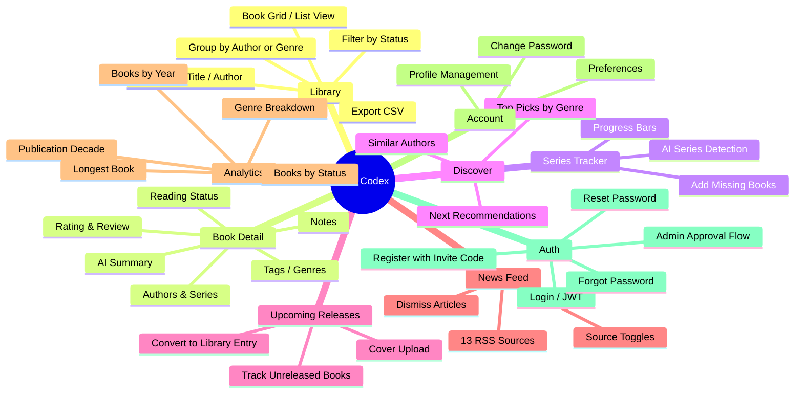
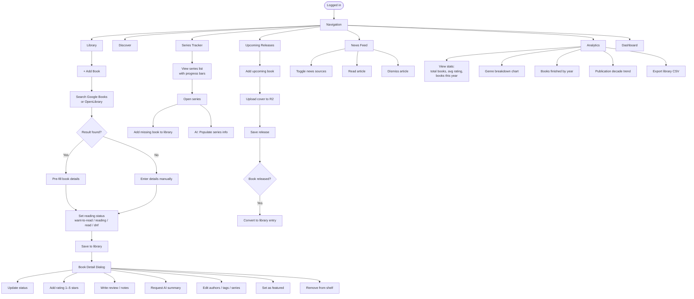
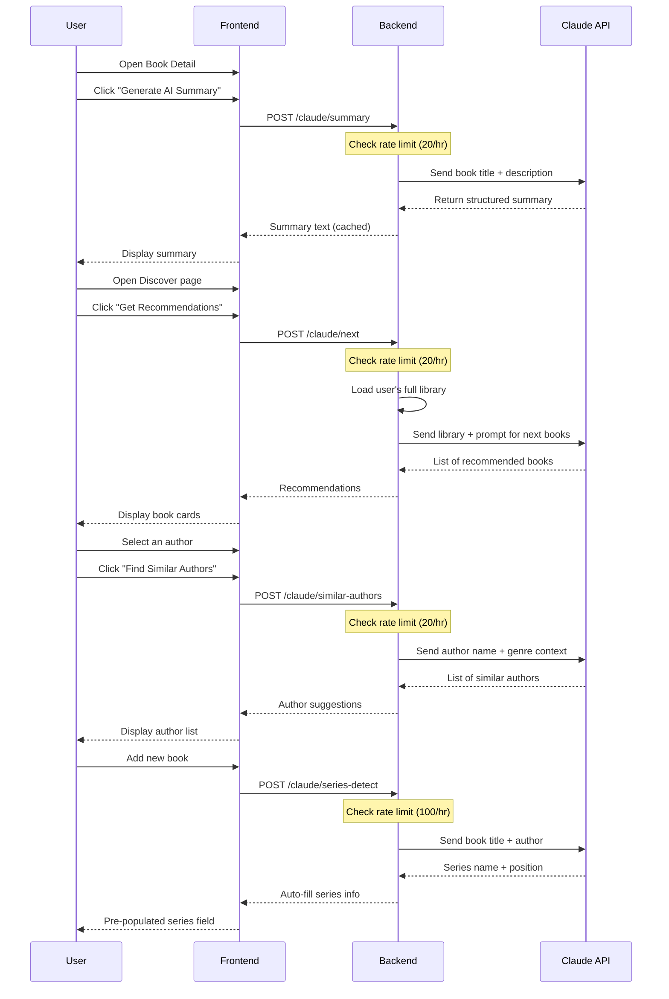
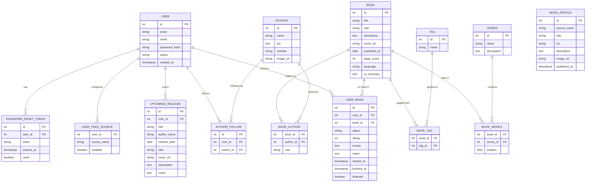
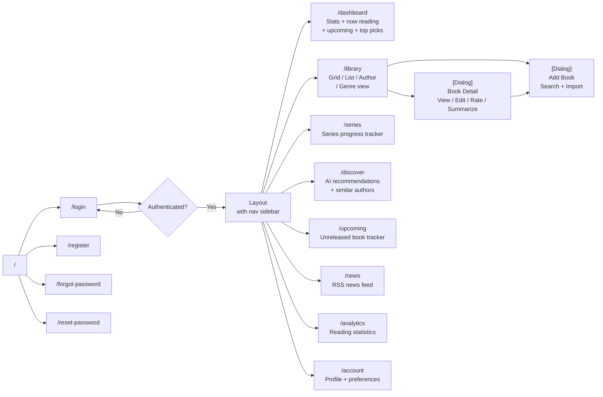
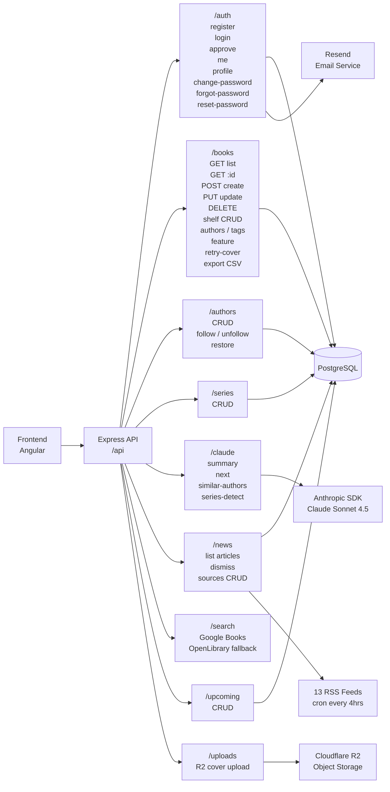

# Zig's Codex — App Flow & Feature Diagrams

---

## 1. Feature Map (App Overview)



---

## 2. Authentication Flow

```mermaid
flowchart TD
    A([User visits app]) --> B{Has JWT token?}
    B -- Yes --> C{Token valid?}
    C -- Yes --> D([Enter app])
    C -- No --> E([/login page])
    B -- No --> E

    E --> F{New user?}
    F -- No --> G[Enter email + password]
    F -- Yes --> H[/register page]

    H --> I[Enter name, email, password\n+ invite code]
    I --> J{First user\never?}
    J -- Yes --> K[Auto-activated]
    J -- No --> L[Status: pending]
    L --> M[Admin receives\napproval email]
    M --> N[Admin clicks\napproval link]
    N --> O[Account activated]
    K --> P[JWT issued]
    O --> P

    G --> Q{Credentials valid?}
    Q -- Yes --> P
    Q -- No --> R[Error: invalid credentials]
    R --> G

    P --> D

    E --> S[Forgot password?]
    S --> T[Enter email]
    T --> U[Reset email sent\ntoken expires in 1hr]
    U --> V[Click link in email]
    V --> W[Enter new password]
    W --> X[Password updated]
    X --> E
```

---

## 3. Core User Flows



---

## 4. AI Features Flow



---

## 5. Data Model (Entity Relationships)



---

## 6. Navigation & Routing Map



---

## 7. Backend API Map


